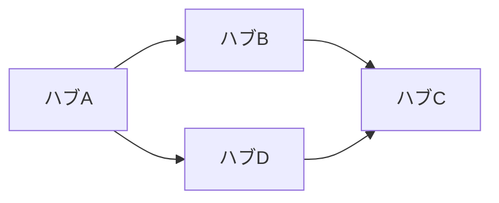

# 静的なDAGによるハブ連結

## 接続方向とネゴシエーション

`A → B` は、AのクライアントがB配下のソースを発見・利用できることを意味します。各ハブは静的設定に従って起動時に下流の構成・識別情報を交換し、到達範囲全体がDAGであると検証できてから連結を有効化します。受信用の認証設定は逆向きの公開・探索経路を作りません。



この合流は許可し、`A → B → A` のような有向閉路は訪問履歴とトポロジー検証で拒否します。同じハブを複数経路で参照する場合、プロセス識別子と下流構成の一致も確認します。ハブIDは連結範囲で一意かつ安定した値を割り当てます。

ネゴシエーションの受信処理は相手自身のバックグラウンド初期化を待たず、静的設定から下流を検証するため同時起動に対応します。失敗時は2秒ごとに再試行します。設定変更には再起動が必要です。

全ハブはMSA上にあり、ハブ間通信は `PlatformId/ServiceId` によるMSA通信です。DAG接続設定には物理URLを持たせません。ダミーの物理URLと接続先キーは `Platform.Services` に集約します。

## 探索経路と取得経路

DAGは公開・探索の経路です。A→B→Cで発見した場合も、取得時はMSA通信層がプロバイダまたは所有ハブCまで配送します。

- MSA上のプロバイダ：SDKまたはRESTクライアントから要求を受けた入口ハブAが、そのプロバイダへMSA経由で接続します。
- 外部プロバイダ：入口ハブAが所有ハブCの `HubRelayApi.ReadSource` を呼び、Cだけが外部ノードに接続します。
- 所有ハブCへの中継要求にAやBのソースIDを指定すると拒否します。中継RPCがさらに別ハブを呼ぶことはありません。

カタログは所有ハブの論理サービス名、プロバイダの配置、API版、探索経路を運びます。外部ノードの物理アドレスとキーは所有ハブのみに置きます。[配置と通信層](PLATFORM.md) に具体例があります。

## 状態と可用性

**初回は到達範囲全体のDAG検証を必要とし、その後は確認済みの構成と一時的な到達性障害を区別します。** B停止時はDegradedとなり、確認済みのA→D→C経路の探索・取得を継続します。探索結果のunavailableHubsには失敗した分岐を返します。

保持するのは最後に全体を検証したハブIDと起動識別子の対応だけで、ソース一覧は引き続き要求時に取得します。各探索RPCに確認済みの相手の起動識別子を指定し、再起動した相手は再ネゴシエーションが成功するまで拒否します。循環構成で再起動したハブの新しい接続も採用しません。訪問履歴の検証も毎回行います。

既定の再検証間隔は10秒、失敗時は2秒です。成功でReadyへ戻ります。設定はプロセス起動中に変更しない前提のため、構成の有効性を時間で失効させず、相手の起動識別子で確認します。自身の再起動で保持情報は消え、再び初回の全体検証が必要です。初回検証に失敗してもローカル登録・取得は継続します。

再起動した直下の相手を再採用するには、接続元ハブから到達できる範囲全体の再検証が必要です。探索が中間ハブを通ると、その先の照合には中間ハブ自身の最新の検証結果を使います。

ローカルの4ハブ試験で、A→B→CとA→Dの構成を検証しました。Dを停止してAがDegradedになった後でCを再起動し、新しいソースをCに登録すると、Bの再検証後にそのソースがAの一覧に現れました。その間、Aの最終検証時刻は変わらず、一覧の `unavailableHubs` にはDが記録されました。入口Aの検証済み構成に孫ハブまで固定する保証が必要な場合、現行実装にはその照合が不足しています。[承認単位の設計判断](REVIEW.md#残る設計判断)

| API | 内容 |
| --- | --- |
| `GET /api/federation` | ハブID、状態、最終検証成功時刻、エラー |
| `GET /api/federation/ready` | 確認済み構成を保持していれば200（Degradedを含む）、未確認なら503 |
| `GET /api/sources` | ソース一覧と探索状態 |

クライアント用 `x-api-key` が必要です。状態はStarting、Ready、Degraded、Rejected、Unavailableです。readinessは全ハブの到達性を保証するものではなく、探索の完全性はunavailableHubsとtruncatedで判断します。トポロジーは最大4ホップ、128ハブ、各ハブの接続先は最大8です。上限を超えて全体を検証できない構成は拒否します。探索範囲の `Federation.MaxHops` は0〜4、既定3です。トポロジー検証の範囲を狭める設定ではありません。

## ソースと探索結果

ソースIDはローカル・遠隔とも `所有ハブID/ローカルソースID` だけです。公開一覧は `id` と `displayName` を返します。IDの各要素は1〜100文字の英数字、`.`、`_`、`-` です。

要求時にカタログを探索し、同じ完全修飾IDを重複除去します。最短経路、同じ長さならハブID列の辞書順で探索経路を選びます。取得時にも再解決するため、所有ハブの登録リースが切れると次の探索から消えます。

gRPC `SourceList` とREST `/api/sources` は `sources`、`unavailableHubs`、`truncated` を返します。下流の探索失敗・検証未完了はunavailableHubs、探索ホップ・1,000件の結果上限はtruncatedで表します。探索が不完全で遠隔ソースを解決できなければUnavailable / HTTP 503、完全な探索で見つからなければNotFound / HTTP 404です。

## 認証

`Federation.Peers` は送信先、`Federation.TrustedHubs` は受信を許可するハブと専用キーです。送信キーを受信側のキーに一致させます。専用認証はFederationApiだけに有効で、HubApiやHubRelayApiには使用できません。

宛先の `PlatformId` と `ServiceId` を省略すると接続先ハブIDと `data-hub` になります。ハブIDとプラットフォームIDが異なる場合は明示します。データ取得・中継用の宛先キーはダミーの `Platform.Services` に設定します。利用者の委譲・署名付き取得許可は後続の設計対象です。

## A→Bの起動例

`dotnet build DataHub.slnx -m:1` の後、別々のターミナルで起動します。Aは5000/5002、Bは5100/5102、BのMSAプロバイダは5003です。

ハブA：

```powershell
$env:Federation__HubId = 'hub-a'
$env:Platform__Id = 'platform-a'
$env:Federation__Peers__0__HubId = 'hub-b'
$env:Federation__Peers__0__PlatformId = 'platform-b'
$env:Federation__Peers__0__ApiKey = 'demo-a-to-b'
$env:Platform__Services__0__PlatformId = 'platform-b'
$env:Platform__Services__0__ServiceId = 'provider-file'
$env:Platform__Services__0__Endpoint = 'http://localhost:5003'
$env:Platform__Services__0__ApiKey = 'demo-provider-b'
$env:Platform__Services__1__PlatformId = 'platform-b'
$env:Platform__Services__1__ServiceId = 'data-hub'
$env:Platform__Services__1__Endpoint = 'http://localhost:5102'
$env:Platform__Services__1__ApiKey = 'demo-client-b'
dotnet run --project src/Hub/Hub.csproj --no-build
```

ハブB：

```powershell
$env:ApiKey = 'demo-client-b'
$env:Federation__HubId = 'hub-b'
$env:Platform__Id = 'platform-b'
$env:Federation__TrustedHubs__0__HubId = 'hub-a'
$env:Federation__TrustedHubs__0__ApiKey = 'demo-a-to-b'
$env:Kestrel__Endpoints__Rest__Url = 'http://localhost:5100'
$env:Kestrel__Endpoints__Grpc__Url = 'http://localhost:5102'
$env:Platform__Services__0__PlatformId = 'platform-b'
$env:Platform__Services__0__ApiKey = 'demo-provider-b'
dotnet run --project src/Hub/Hub.csproj --no-build
```

プロバイダ：

```powershell
$env:ApiKey = 'demo-provider-b'
$env:Platform__Id = 'platform-b'
$env:Platform__Services__0__PlatformId = 'platform-b'
$env:Platform__Services__0__Endpoint = 'http://localhost:5102'
$env:Platform__Services__0__ApiKey = 'demo-client-b'
dotnet run --project src/Provider/Provider.csproj --no-build
```

AのRESTで `GET /api/records?sourceId=hub-b/file-press-01` を要求できます。B配下を外部ノードに置き換える場合は[外部ノード設定](PLATFORM.md)のとおりBだけにExternalNodesを設定します。

## 結合試験

`dotnet tests/FederationSmoke/bin/Debug/net10.0/FederationSmoke.dll` は合流DAGと循環構成、両配置のプロバイダを起動します。4パターン、担当ハブ中継、入力検証、宛先・所有ハブの取り違え拒否、認証分離、分断・復旧、外部ノード障害、リース期限切れを確認します。入口ハブとSDKには外部ノードの対応表・キーを与えていません。

使用ポートは6100/6102、6200/6202、6300/6302、6400/6402、6500/6502、6600/6602、6113、6313、6333です。実MSAのゲートウェイやファイアウォールによる到達制限は、このローカル試験の範囲外です。
