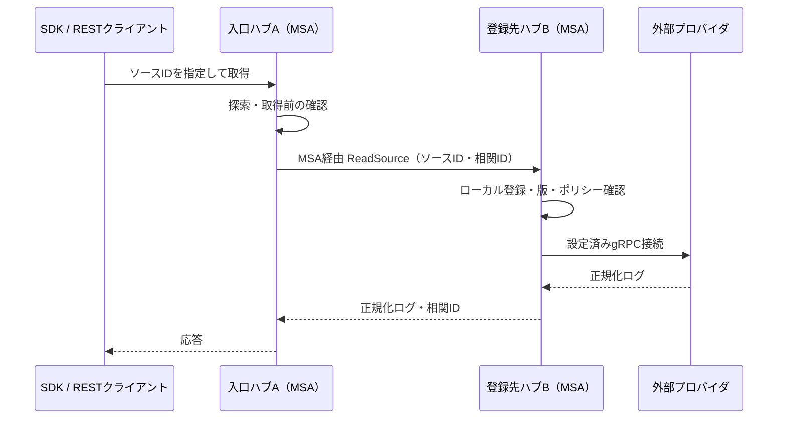

# 配置と取得経路

ハブはすべてMSAプラットフォーム上に配置します。MSA上のクライアントはgRPC SDK、外部クライアントは入口ハブのREST APIを利用します。プロバイダはMSA上または外部ノードのいずれかです。

## 経路の決め方

登録する `ProviderTarget` は `platform_service` と `external_node_id` のoneofです。配置の種類と接続先を同時に表すため、独立した転送モードや複数のURL項目はありません。

- MSAプロバイダ：入口ハブがMSA共通通信層でプロバイダを呼びます。
- 外部プロバイダ：入口ハブがMSA共通通信層で登録先ハブの `HubRelayApi.ReadSource` を呼び、登録先ハブが外部ノードへ接続します。入口と登録先が同一ならハブ間RPCは不要です。



DAGは探索の経路です。A→X→Bで発見した外部プロバイダは、入口ハブAからMSA経由で所有ハブBに中継します。中継RPCは宛先ハブIDを確認し、自ハブの登録だけを読みます。別ハブのソースは拒否し、再転送しません。

外部ノードは登録先ハブ／そのMSAから到達できればよく、入口ハブやSDKからの到達性は要求しません。外部プロバイダは登録先ハブの公開gRPC入口へ登録・更新できる必要があります。逆接続やNATトンネルは実装していません。外部ノードへの直接到達が可能なSDKでも、この実装では所有ハブ経由に統一します。

## 通信層と内部モデル

- `IPlatformGrpcClientFactory.Create(ServiceAddress)`：MSAサービスの名前解決・配送。独自基盤の共通gRPCクライアントに差し替えます。ゲートウェイURLは契約に露出しません。
- `StaticPlatformGrpcClientFactory`：開発用の論理名→URL・宛先キー対応表。全ハブ間通信とMSAプロバイダ通信に使用します。
- `ExternalNodeClients`：外部ノードID→URL・宛先キーの対応表。登録先ハブだけに設定します。
- `GrpcConnections`：信頼済み設定に基づくgRPC接続の再利用と宛先キー付与。HTTPリダイレクトは追従しません。
- `IProviderReader`：ハブの取得処理の差し替え口。MSAプロバイダ、自ハブ配下の外部ノード、遠隔ハブ配下の外部ノードを振り分けます。

`SourceDescriptor` は登録先の論理的な情報、`DiscoveredSource` は所有ハブと探索経路を保持します。protobufの可変メッセージは保存せず、境界で変換します。カタログに物理URLや資格情報を載せません。対応表がなければUnavailableになり、別の経路への暗黙のフォールバックはありません。

## MSA上のプロバイダ

プロバイダの `Platform.Id`、`Platform.ServiceId` が自分の論理名です。登録先は `HubPlatformId`（省略時は自分のPlatform.Id）と `HubServiceId`（既定data-hub）です。

ダミーでは、プロバイダの `Platform.Services` に登録先ハブのURLと認証キーを設定します。ハブには利用するMSAサービスの対応表を設定します。SDKに必要なのは入口ハブの対応表です。独自基盤への差し替え後は基盤が名前解決・配送を担当します。

```json
{
  "Platform": {
    "Id": "platform-b",
    "ServiceId": "provider-file",
    "Services": [
      { "PlatformId": "platform-b", "ServiceId": "data-hub", "Endpoint": "http://localhost:5102", "ApiKey": "hub-b-key" }
    ]
  }
}
```

## 外部プロバイダ

以下は設定への追加例です。外部プロバイダ自身はMSAクライアントを使用せず、明示した登録先ハブのgRPC入口へ接続します。

外部プロバイダ側：

```json
{
  "ExternalNodeId": "factory-b-outside-01",
  "SourceId": "press-log",
  "DisplayName": "Outside press",
  "ApiKey": "provider-b-key",
  "HubEndpoint": "http://localhost:5102",
  "HubApiKey": "hub-b-key",
  "Kestrel": {
    "Endpoints": {
      "Grpc": { "Url": "http://localhost:5103", "Protocols": "Http2" }
    }
  }
}
```

登録先ハブB側：

```json
{
  "ExternalNodes": [
    { "NodeId": "factory-b-outside-01", "Endpoint": "http://localhost:5103", "ApiKey": "provider-b-key" }
  ]
}
```

外部ノードIDは安定した一意の値を割り当てます。登録先ハブBは `factory-b-outside-01` を物理アドレスに解決します。入口ハブAにはハブBのMSA論理名への接続を設定します。`HubApiKey` とプロバイダ自身の `ApiKey` は役割が異なり、同一である必要はありません。

プロバイダは要求されたローカルソースIDと `ProviderTarget` を自分の設定と照合します。これは名前解決や設定の取り違えを検出する整合性確認であり、利用者認可ではありません。

## SDK

```csharp
using DataHub.Client;
using DataHub.Platform;

using var platform = new StaticPlatformGrpcClientFactory(new PlatformOptions {
    Services = [
        new StaticService { PlatformId = "platform-a", ServiceId = "data-hub", Endpoint = "http://localhost:5002", ApiKey = "hub-a-key" }
    ]
});
var client = new DataHubClient(platform, new("platform-a", "data-hub"));
await client.SelectSourceAsync("hub-b/press-log");
var result = await client.ReadAsync(limit: 10);
```

同じSDK呼び出しでMSA／外部プロバイダを利用します。`SelectSourceAsync` はソースIDの形式を検証し、SDKインスタンス内に保存します。ソースの存在とポリシーは取得時に入口ハブが確認します。SDKは入口ハブの `HubApi.Read` を呼び、期限とキャンセルを伝播します。取得開始後の選択変更は、その取得に影響しません。

ハブでの取得期限は `Read.TimeoutSeconds`（既定30、1〜120）で設定します。呼出元の期限が短ければそちらを優先します。入口ハブからの取得と所有ハブの中継に同じ設定を適用し、DAGの探索期限 `Federation.DiscoveryTimeoutSeconds` とは独立しています。SDK自身の要求全体の期限は30秒です。

gRPCの `HubApi.Read` は完全修飾 `source_id`、件数、任意の相関IDを受け取ります。RESTの `GET /api/records` も `sourceId` を受け取ります。各要求はそのIDを解決するため、リース失効後はNotFound／HTTP 404です。

旧 `SelectSource`、`GetSelectedSource`、`PrepareRead` RPCとクライアント別REST選択APIは削除しています。SDKのコンストラクターもクライアントIDを受け取りません。旧 `ReadRequest` のクライアントIDと選択照合用のフィールド番号は予約し、新しい `source_id` に再利用していません。

プロバイダは `MaxPendingReads` で待機数を制限し、読込中に `DataLimits` のレコード／応答サイズをprotobufの符号化サイズで検査します。REST JSONはエスケープによりprotobufサイズを上回ることがあり、実際のJSONバイト数はこの上限の対象外です。gRPCのResourceExhaustedに付ける `datahub-limit` トレーラーは `capacity` または `payload` で、所有ハブ・入口ハブがそのまま伝播します。RESTはそれぞれ429／422へ変換します。未分類の上流ResourceExhaustedは502です。

取得元の追加は `ILogSource.ReadAsync` から `IAsyncEnumerable<LogRecord>` を返すアダプタを実装します。共通の `LogReader` がレート・サイズを制限し、予算超過時は列挙を中止してアダプタのリソースを破棄します。JSONは逐次読込、PostgreSQLはLIMITに加えて文字列列をレコード予算の文字数+1に制限して取得します。長すぎる値はサイズ超過として拒否され、切り詰めた成功データは返しません。実PostgreSQLでの実行計画・性能の確認は別途必要です。

## 認可・監査の実装範囲

`IReadRequestPolicy` は現在API版・入力の確認のみです。共有キーを知る相手はSDKや入口ハブを通さずProviderApiやHubRelayApiを呼べるため、取得許可の署名・利用者の委譲・失効管理は後続の設計対象です。中継先でもローカル登録を読み直し、ポリシーを評価します。

`IReadAuditSink` はPrepared／Completed／Failedを構造化ログに記録します。入口、所有ハブ、プロバイダに同じ相関IDを伝播します。監査の永続化・欠落検知・再送は未実装です。相関IDは認証情報ではありません。
